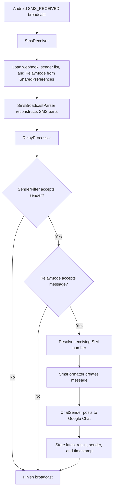

# Architecture

## Overview

SMS Relay is a single-module Android application built around the `SMS_RECEIVED` system broadcast. It avoids an always-running service and performs work only when an SMS arrives or the user opens the configuration activity.

## Runtime Flow

## Components

### `MainActivity`

The launcher activity uses View Binding over the existing XML layout and provides a focused,
card-based configuration surface. It:

- Requests `RECEIVE_SMS` and `READ_PHONE_NUMBERS` at runtime
- Validates that the webhook uses the Google Chat HTTPS prefix
- Presents **OTP messages only** and **All incoming messages** choices in a dropdown with a visible
  chevron
- Shows contextual guidance for the selected mode and visually marks unsaved edits
- Masks the webhook by default and provides an explicit Show/Hide control
- Shows a dedicated privacy warning when **All incoming messages** is selected
- Stores the webhook and relay mode in the app-private `relay` preferences file
- Stores an optional sender allow-list in the same app-private preferences file; blank allows all
  senders
- Displays compact `Setup`, `Active`, `Unsaved`, `Invalid`, `Testing`, `Connected`, and `Failed`
  configuration/test states in a header badge
- Displays most-recent-relay metadata in a separate delivered/failed card only when a record exists
- Keeps **Test connection** as a secondary outlined action and **Save configuration** as the primary
  action; both are equal-width, 48dp AppCompat controls with explicit untinted backgrounds
- Links to a read-only **About & Privacy** screen
- Shows the installed version at the end of the screen
- Uses a compact, width-capped layout that fits a standard phone screen without scrolling, while
  retaining scrolling as a fallback for small landscape windows and large accessibility text

It does not participate in SMS delivery and does not need to remain open.

The header badge represents configuration and connection-test state, not the result of the latest
incoming SMS. The latest-relay card represents that delivery record and is independently updated by
the preference listener. This separation avoids duplicating active-state content and keeps SMS
metadata out of transient configuration feedback.

`ConfigurationState` calculates persisted, active, and unsaved form states without depending on
Android views. `MainActivity` maps those states onto the existing badge resources.

### `AboutPrivacyActivity`

This read-only activity explains local storage, Google Chat transmission, permissions, and user
controls. It does not read or change the webhook, sender list, relay mode, or last-relay record.

The UI label **All incoming messages** maps to the persisted `RelayMode.ALL_MESSAGES` value. Changing
the field selection alone does not update preferences; the user must explicitly save it.

### `SmsReceiver`

The manifest-registered broadcast receiver owns the Android broadcast lifetime. It:

- Accepts only the Android SMS-received action
- Calls `goAsync()` before leaving the receiver callback
- Dispatches processing to one shared single-thread executor
- Delegates multipart reconstruction and Android metadata extraction to `SmsBroadcastParser`
- Delegates sender filtering, relay-mode selection, and request preparation to `RelayProcessor`
- Resolves the SIM number lazily only after a message qualifies
- Sends the prepared request and records its result
- Overwrites the last-relay record with the delivery result, sender, and SMS timestamp
- Finishes the pending broadcast in a `finally` block

The single-thread executor serializes simultaneous messages and prevents one thread from being created per SMS.

### `SmsBroadcastParser`

The parser is the Android-facing boundary for SMS intent payloads. It reconstructs multipart bodies
in platform-provided order, selects the first originating address, derives the earliest timestamp,
and reads the receiving subscription identifier. It returns a small `IncomingSms` model.

### `RelayProcessor`

The processor is independent from Android broadcast objects. It applies the optional sender
allow-list and saved relay mode, resolves the receiving number only for qualifying messages, and
prepares the stable formatted request consumed by `ChatSender`.

### `OtpParser`

The parser is a stateless regex-based filter. It accepts:

- A 4–8 digit value following an OTP-related keyword
- Any standalone six-digit value

It does not modify the SMS. Once accepted, the complete original body is forwarded.

### `RelayMode`

The mode is a pure enum with two values:

- `OTP_ONLY` delegates classification to `OtpParser`.
- `ALL_MESSAGES`, shown as **All incoming messages** in the UI, accepts every non-empty body passed
  to it by the receiver.

Missing or unknown stored values resolve to `OTP_ONLY`, preserving the previous behavior for
existing installations.

### `SenderFilter`

The sender filter is a pure allow-list gate. It accepts comma-, semicolon-, or newline-separated
sender addresses, ignores case and common phone-number formatting characters when matching, and
allows every sender when no entries are configured. Existing installations therefore retain their
previous sender behavior.

### `SimNumberResolver`

The resolver reads the receiving subscription ID from the broadcast intent and tries platform phone-number APIs covered by `READ_PHONE_NUMBERS`. An unavailable permission, unsupported carrier, missing number, or platform error produces `Unknown`.

### `SmsFormatter`

The formatter creates a stable plain-text message containing:

- Receiving number
- Sender
- Device-local timestamp
- Original SMS body

### `ChatSender`

The sender builds its payload with the platform `JSONObject` encoder and posts it through
`HttpURLConnection`. It uses explicit connection and read timeouts, closes each connection, and
makes no more than three attempts. Injectable connection and delay functions allow deterministic
JVM verification without changing the production API.

### `LastRelayStatus`

The status model and store retain exactly one relay result in app-private preferences. The record
contains delivered/failed state, sender, and SMS timestamp. It never receives or stores the SMS
body, OTP, receiving number, or webhook.

## State and Data Boundaries

| Data                   | Location                             | Lifetime                                                   |
|------------------------|--------------------------------------|------------------------------------------------------------|
| Google Chat webhook    | App-private `SharedPreferences`      | Until replaced, app data is cleared, or the app is removed |
| Relay mode             | App-private `SharedPreferences`      | Until replaced, app data is cleared, or the app is removed |
| Sender allow-list      | App-private `SharedPreferences`      | Until replaced, app data is cleared, or the app is removed |
| Incoming SMS body      | Broadcast payload and process memory | During processing                                          |
| Formatted Chat message | Process memory                       | During delivery                                            |
| Latest relay metadata  | App-private `SharedPreferences`      | Until overwritten, app data is cleared, or app is removed  |
| OTP history            | Not stored                           | None                                                       |

## Delivery Semantics

Delivery is best-effort:

- A failed request is retried within the current process.
- Failed messages are not persisted for later delivery.
- The latest failed status indicates that the bounded in-process retries were exhausted; it does
  not schedule another retry.
- A request accepted by Google followed by a lost response can be sent again.
- There is no duplicate-suppression or idempotency key.
- Process termination can interrupt queued or active work.

These tradeoffs keep the app small and battery-efficient but do not provide guaranteed delivery.

## Platform and Security Boundaries

- The receiver requires the system `BROADCAST_SMS` permission from its sender.
- The application requests only SMS reception, phone-number access, and internet access.
- App backup is disabled.
- The phone number may legitimately be unavailable even when permission is granted.
- The webhook is a credential and must not appear in source control or logs.
- **All incoming messages** mode expands the transmitted data from likely OTPs to every incoming
  SMS.

See [PRIVACY.md](PRIVACY.md) and [../SECURITY.md](../SECURITY.md) for data-handling and vulnerability guidance.

## Design Constraints

The current architecture intentionally excludes:

- Foreground services
- Polling and periodic workers
- Alarms and timers
- Wake locks
- SMS database access
- MMS handling
- Analytics and telemetry
- Persistent delivery queues

Adding one of these mechanisms should include a documented requirement, battery and privacy impact, failure strategy, and test plan.
