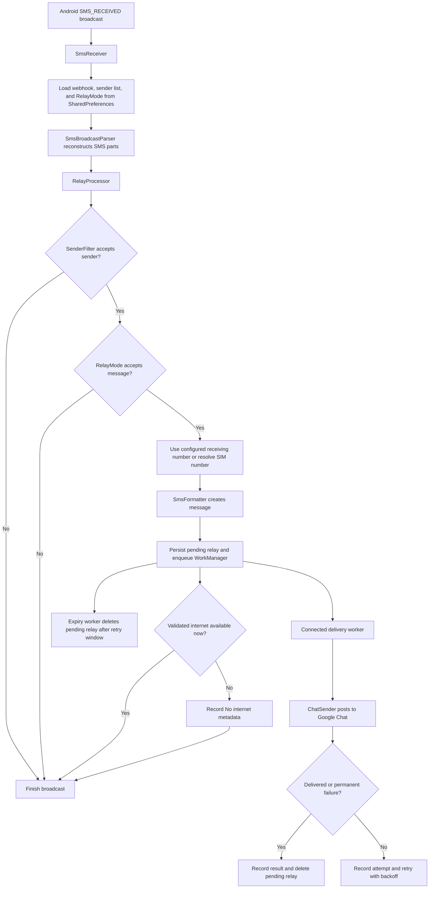

# Architecture

## Overview

SMS Relay is a single-module Android application built around the `SMS_RECEIVED` system broadcast. It avoids an always-running service and performs work only when an SMS arrives or the user opens the configuration activity.

## Runtime Flow

## Components

### `MainActivity`

The launcher activity uses View Binding over the existing XML layout and provides a focused,
card-based configuration surface. It:

- Requests `RECEIVE_SMS` and `READ_PHONE_NUMBERS` at runtime
- Validates that the webhook uses the Google Chat HTTPS prefix
- Presents **OTP messages only** and **All incoming messages** choices in a dropdown with a visible
  chevron
- Shows contextual guidance for the selected mode and visually marks unsaved edits
- Masks the webhook by default and provides an explicit Show/Hide control
- Shows a dedicated privacy warning when **All incoming messages** is selected
- Stores the webhook and relay mode in the app-private `relay` preferences file
- Stores an optional receiving-number override for carriers that do not expose the SIM number
- Stores an optional sender allow-list in the same app-private preferences file; blank allows all
  senders
- Displays compact `Setup`, `Active`, `Unsaved`, `Invalid`, `Testing`, `Connected`, and `Failed`
  configuration/test states in a header badge
- Displays most-recent-relay metadata in a tappable delivered/failed card only when a record exists
- Opens `RelayHistoryActivity` from that card
- Keeps **Test connection** as a secondary outlined action and **Save configuration** as the primary
  action; both are equal-width, 48dp AppCompat controls with explicit untinted backgrounds
- Links to a read-only **About & Privacy** screen
- Keeps the installed version pinned to the bottom of the screen, outside the scrolling content
- Uses a compact, width-capped layout that fits a standard phone screen without scrolling, while
  retaining scrolling as a fallback for small landscape windows and large accessibility text

It does not participate in SMS delivery and does not need to remain open.

The header badge represents configuration and connection-test state, not the result of the latest
incoming SMS. The latest-relay card represents that delivery record and is independently updated by
the preference listener. This separation avoids duplicating active-state content and keeps SMS
metadata out of transient configuration feedback.

### `RelayHistoryActivity`

This read-only screen lists all locally recorded relay attempts newest first. Each row contains the
delivery result, sender, SMS timestamp, and a privacy-safe failure reason when delivery failed. It
does not display or load SMS bodies, OTPs, receiving numbers, webhook URLs, host addresses, or raw
exception text.
An outlined destructive action requires confirmation, then clears the history database and latest
home-card metadata without changing the webhook, relay mode, or sender allow-list.

`ConfigurationState` calculates persisted, active, and unsaved form states without depending on
Android views. `MainActivity` maps those states onto the existing badge resources.

### `AboutPrivacyActivity`

This read-only activity explains local storage, Google Chat transmission, permissions, and user
controls. It does not read or change the webhook, sender list, relay mode, or last-relay record.

The UI label **All incoming messages** maps to the persisted `RelayMode.ALL_MESSAGES` value. Changing
the field selection alone does not update preferences; the user must explicitly save it.

### `SmsReceiver`

The manifest-registered broadcast receiver owns the Android broadcast lifetime. It:

- Accepts only the Android SMS-received action
- Calls `goAsync()` before leaving the receiver callback
- Dispatches processing to one shared single-thread executor
- Delegates multipart reconstruction and Android metadata extraction to `SmsBroadcastParser`
- Delegates sender filtering, relay-mode selection, and request preparation to `RelayProcessor`
- Resolves the SIM number lazily only after a message qualifies
- Persists the prepared request and enqueues delivery and expiry work
- Records an immediate privacy-safe no-internet result when appropriate
- Finishes the pending broadcast in a `finally` block

The single-thread executor serializes simultaneous messages and prevents one thread from being created per SMS.

### `SmsBroadcastParser`

The parser is the Android-facing boundary for SMS intent payloads. It reconstructs multipart bodies
in platform-provided order, selects the first originating address, derives the earliest timestamp,
and reads the receiving subscription identifier. It returns a small `IncomingSms` model.

### `RelayProcessor`

The processor is independent from Android broadcast objects. It applies the optional sender
allow-list and saved relay mode, resolves the receiving number only for qualifying messages, and
prepares the stable formatted request consumed by `ChatSender`.

### `OtpParser`

The parser is a stateless regex-based filter. It accepts:

- A 4–8 digit value following an OTP-related keyword
- Any standalone six-digit value

It does not modify the SMS. Once accepted, the complete original body is forwarded.

### `RelayMode`

The mode is a pure enum with two values:

- `OTP_ONLY` delegates classification to `OtpParser`.
- `ALL_MESSAGES`, shown as **All incoming messages** in the UI, accepts every non-empty body passed
  to it by the receiver.

Missing or unknown stored values resolve to `OTP_ONLY`, preserving the previous behavior for
existing installations.

### `SenderFilter`

The sender filter is a pure allow-list gate. It accepts comma-, semicolon-, or newline-separated
sender addresses, ignores case and common phone-number formatting characters when matching, and
allows every sender when no entries are configured. Existing installations therefore retain their
previous sender behavior.

### `SimNumberResolver`

The resolver reads the receiving subscription ID from the broadcast intent and tries platform phone-number APIs covered by `READ_PHONE_NUMBERS`. An unavailable permission, unsupported carrier, missing number, or platform error produces `Unknown`.

### `SmsFormatter`

The formatter creates a stable plain-text message containing:

- Receiving number
- Sender
- Device-local timestamp
- Original SMS body

### `ChatSender`

The sender builds its payload with the platform `JSONObject` encoder and posts it through
`HttpURLConnection`. It uses a shared eight-second delivery budget, caps connect and read stages at
two seconds, closes each connection, and makes no more than three attempts when time remains. Its result distinguishes HTTP status,
connection timeout, response timeout, DNS failure, and another network failure without retaining
URLs or exception messages. Injectable connection and delay functions allow deterministic JVM
verification without changing the production API.

`SmsReceiver` persists each prepared request in `PendingRelayStore`, enqueues unique one-time
WorkManager jobs, and finishes the broadcast without waiting for network I/O. The delivery worker
requires a connected network, calls `ChatSender`, and retries transient network failures and HTTP
408, 429, and 5xx responses with exponential backoff. Permanent HTTP failures and successful
deliveries remove the pending record.

A separate unconstrained expiry job removes an undelivered record after the 24-hour retry window,
even when the phone remains offline. It records the privacy-safe `RETRY_EXPIRED` reason. If Android
reports no validated internet when the SMS arrives, the receiver immediately records
`NO_INTERNET`; the queued worker can still deliver after connectivity returns.

### `LastRelayStatus`

The status model and store retain exactly one relay result in app-private preferences. The record
contains delivered/failed state, sender, SMS timestamp, and a privacy-safe failure category or HTTP
status. It never receives or stores the SMS body, OTP, receiving number, webhook, host address, or
exception text.

### `RelayHistoryStore`

The history store uses an app-private SQLite database and returns entries newest first. Existing
installations migrate their one legacy latest-relay record into history once. History remains until
app data is cleared or the app is removed; it is display-only and is not a delivery or retry queue.

## State and Data Boundaries

| Data                   | Location                             | Lifetime                                                   |
|------------------------|--------------------------------------|------------------------------------------------------------|
| Google Chat webhook    | App-private `SharedPreferences`      | Until replaced, app data is cleared, or the app is removed |
| Relay mode             | App-private `SharedPreferences`      | Until replaced, app data is cleared, or the app is removed |
| Receiving-number override | App-private `SharedPreferences`   | Until replaced, app data is cleared, or the app is removed |
| Sender allow-list      | App-private `SharedPreferences`      | Until replaced, app data is cleared, or the app is removed |
| Pending relay request  | App-private SQLite database           | Until delivered, permanently failed, or 24 hours elapse    |
| Latest relay metadata  | App-private `SharedPreferences`      | Until overwritten, app data is cleared, or app is removed  |
| Relay-result history   | App-private SQLite database          | Until app data is cleared or the app is removed             |
| OTP history            | Not stored                           | None                                                       |

## Delivery Semantics

Delivery is best-effort:

- A qualifying request is persisted before the broadcast finishes.
- Transient failures are retried by WorkManager for up to 24 hours and can survive process death or reboot.
- HTTP 4xx responses other than 408 and 429 are treated as permanent failures.
- Failure history may show an intermediate attempt before a later retry succeeds.
- A request accepted by Google followed by a lost response can be sent again.
- There is no duplicate-suppression or idempotency key.
- OEM background restrictions can delay WorkManager execution.

These tradeoffs keep the app small and battery-efficient but do not provide guaranteed delivery.

## Platform and Security Boundaries

- The receiver requires the system `BROADCAST_SMS` permission from its sender.
- The application uses SMS reception, phone-number, internet, network-state, reboot, and wake-lock
  permissions required by its receiver and WorkManager scheduling.
- App backup is disabled.
- The phone number may legitimately be unavailable even when permission is granted.
- The webhook is a credential and must not appear in source control or logs.
- **All incoming messages** mode expands the transmitted data from likely OTPs to every incoming
  SMS.

See [PRIVACY.md](PRIVACY.md) and [../SECURITY.md](../SECURITY.md) for data-handling and vulnerability guidance.

## Design Constraints

The current architecture intentionally excludes:

- Foreground services
- Polling and periodic workers
- Alarms and timers
- App-managed wake locks
- SMS database access
- MMS handling
- Analytics and telemetry

Adding one of these mechanisms should include a documented requirement, battery and privacy impact, failure strategy, and test plan.
